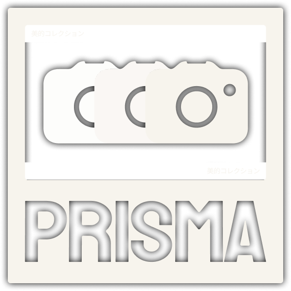
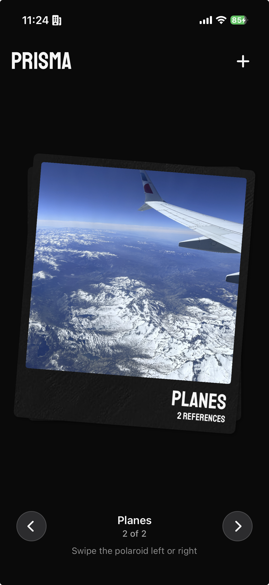
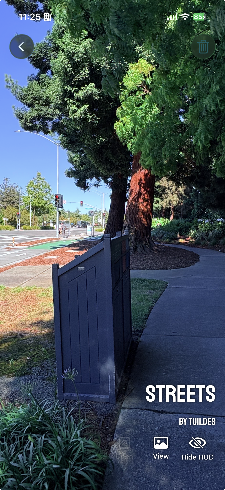
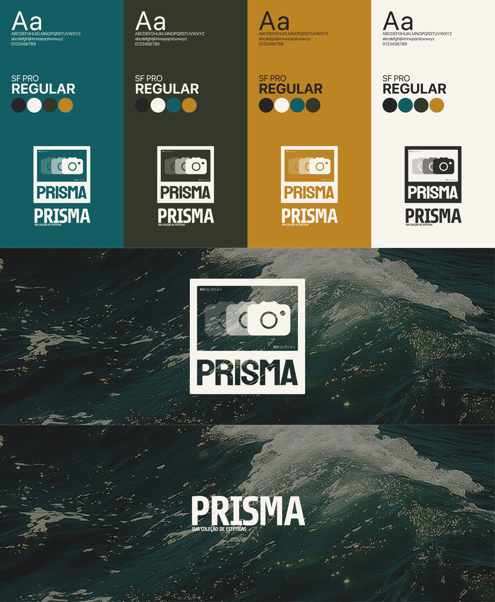

  
  <h3 align="center">Prisma</h3>
  
Your references in Polaroids.

---

## Introduction

**Prisma** is an iOS app for collecting visual references and organizing them into aesthetics. Each aesthetic lives as a polaroid on the home deck — swipe through moods, open a gallery, and keep every image close when inspiration hits.

Create aesthetics with a cover photo, then add reference images with title, author, description, and an optional source URL. Browse them in a grid, open a full-bleed detail view with a hideable HUD, and jump back to the original when you want more context.

  Screenshots

 

    
&nbsp;
    

## Features

- **Polaroid Deck:** Browse aesthetics as a stack of polaroids — swipe left or right, or use the on-screen controls, to move between moods.
- **Aesthetic Galleries:** Open any polaroid to see every reference in a grid, with cover art and counts at a glance.
- **Reference Detail:** Full-bleed image viewing with title and author, optional source link, fullscreen mode, and a HUD you can dim when you want the photo alone.
- **Guided Creation:** Clear required and optional sections when creating aesthetics or images, with forms that stay readable in light and dark mode.
- **Local Persistence:** Everything stays on device with SwiftData — no account required.
- **Quick Actions:** Add a new aesthetic or reference straight from the home-screen long-press menu.

## Technologies

- **Language:** Swift
- **Frameworks:** SwiftUI, SwiftData, PhotosUI
- **Architecture:** MVVM with `@Observable` ViewModels and a central `AppRouter` (`NavigationStack`)
- **Persistence:** Local SwiftData store for aesthetics and reference images
- **Typography:** Custom display typeface (Staatliches)

## Visual Identity

## License

The source code of this application is distributed under the [MIT License](LICENSE).

> **Note:** *The MIT License applies strictly to the source code of this repository. App icon, logo, screenshots, paper textures, and other visual assets retain their original individual licenses and creator copyrights.*
